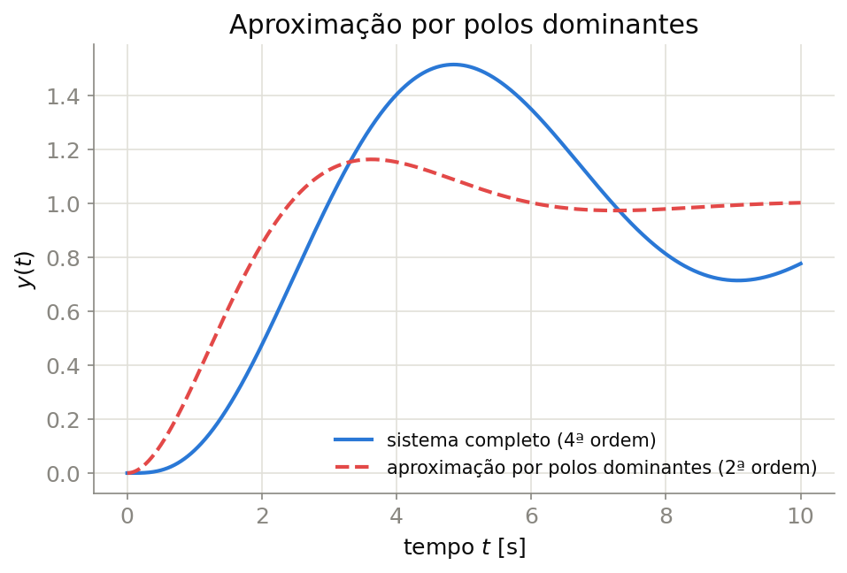
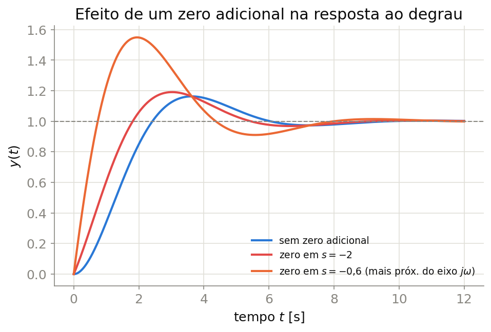
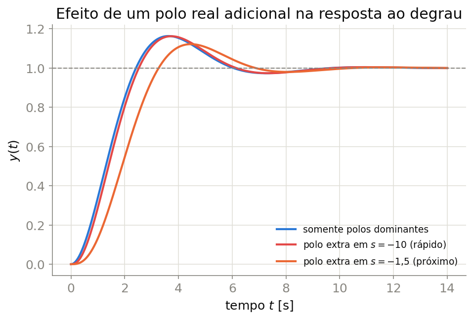
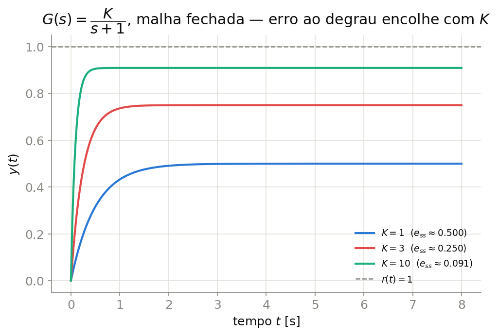
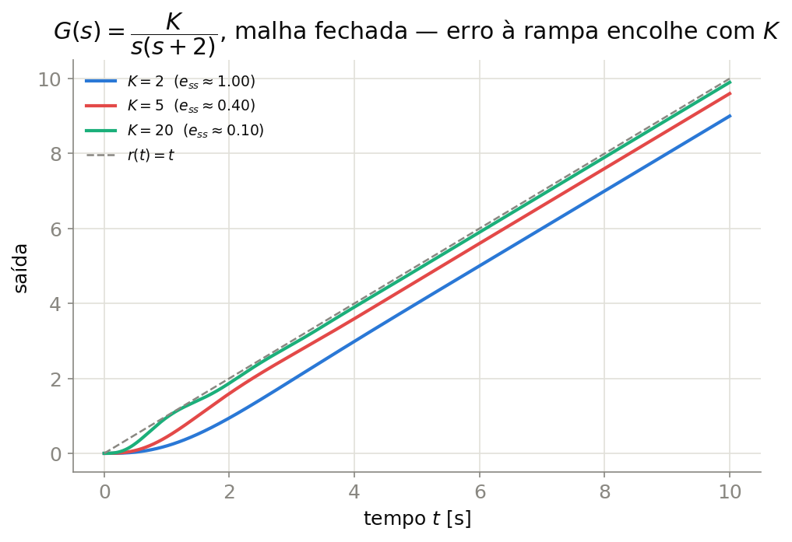

## Sistemas de Ordem Superior

A maioria dos sistemas reais tem **mais de dois polos** (e possivelmente zeros). A resposta ao degrau de um sistema de ordem $n$ com polos distintos é uma soma de modos:

$$y(t) = K + \sum_{i} A_i\,e^{-\sigma_i t} + \sum_{j} B_j\,e^{-\sigma_j t}\cos(\omega_{d,j} t + \phi_j)$$

- Cada polo real contribui um termo exponencial; cada par complexo conjugado, um termo oscilatório amortecido
- As fórmulas de $M_p$, $t_p$, $t_s$ da Aula 4 **não** se aplicam diretamente — mas frequentemente podemos **aproximar** o sistema por um par de polos dominantes

---

## Polos Dominantes

::: {.callout-important}
## Critério de dominância (regra prática)
Um par de polos complexos conjugados é considerado **dominante** se os demais polos têm parte real **pelo menos 5 vezes mais negativa**:

$$\text{Re}(s_{\text{outros}}) \leq 5\times\text{Re}(s_{\text{dominante}})$$
:::

- Modos associados a polos mais à esquerda decaem muito mais rápido ($e^{-\sigma t}$) e contribuem pouco após o transitório inicial
- Se a dominância se verifica, o sistema completo pode ser **aproximado** por um sistema de 2ª ordem equivalente, usando as fórmulas já conhecidas

---

## Aproximação por Polos Dominantes — Exemplo

{width="70%" fig-align="center"}

O sistema de 4ª ordem tem um par de polos dominantes com $\zeta\omega_n \approx 0{,}5$ e dois polos rápidos adicionais — a resposta de 2ª ordem captura bem a forma geral, com pequeno desvio no início.

---

## Cancelamento Polo-Zero

Quando um **zero** está muito próximo de um **polo não-dominante**, seus efeitos se aproximam de um cancelamento mútuo — o resíduo associado àquele modo torna-se pequeno e sua contribuição à resposta é desprezível.

::: {.callout-tip}
Cancelamento (quase) exato de polo-zero é uma técnica de **projeto de controladores** (ex.: controlador PD ou PI cancelando um polo lento da planta) — veremos isso na Aula 10.
:::

::: {.callout-warning}
Cancelamento **nunca é exato** na prática (incerteza de modelo) — polos e zeros próximos, mas não idênticos, ainda geram uma resposta lenta de pequena amplitude ("cauda longa").
:::

---

## Efeito de um Zero Adicional

{width="68%" fig-align="center"}

- Um zero em $s=-a$ (SPE) **aumenta o sobressinal** e **reduz o tempo de subida**
- Quanto mais **próximo do eixo $j\omega$** (menor $a$ em relação a $\zeta\omega_n$), maior o efeito

---

## Zeros de Fase Não-Mínima

Se o zero estiver no **semiplano direito** ($s=+a$, $a>0$), o sistema é dito de **fase não-mínima**:

$$G(s) = \frac{\omega_n^2(1 - s/a)}{s^2+2\zeta\omega_n s+\omega_n^2}$$

- A resposta ao degrau apresenta um **"undershoot"** inicial: a saída parte na direção **oposta** à referência antes de convergir
- Fenômeno comum em: aeronaves (manobra de arfagem), sistemas com atraso de transporte aproximado, alguns processos químicos

::: {.callout-important}
Zeros de fase não-mínima **limitam fundamentalmente** o desempenho alcançável por realimentação — nenhum controlador elimina o undershoot inicial sem violar restrições físicas.
:::

---

## Efeito de um Polo Real Adicional

{width="68%" fig-align="center"}

- Um polo real adicional **sempre reduz o sobressinal** e **aumenta o tempo de subida** (resposta mais lenta)
- Se o polo extra estiver **longe** à esquerda (muito mais rápido que os dominantes), seu efeito é desprezível — validação prática do critério de dominância

---

## Resumo dos Efeitos

| Elemento adicional | Efeito sobre $M_p$ | Efeito sobre $t_r$ | Efeito sobre $t_s$ |
|:--|:--:|:--:|:--:|
| Polo real (SPE), próximo | ↓ reduz | ↑ aumenta | pode aumentar |
| Polo real (SPE), distante | ≈ nulo | ≈ nulo | ≈ nulo |
| Zero real (SPE), próximo | ↑ aumenta | ↓ reduz | pouco efeito |
| Zero real (SPD, fase não-mínima) | *undershoot* inicial | — | pode aumentar |

::: {.callout-tip}
Regra de bolso: **polos atrasam, zeros adiantam** a resposta — e ambos têm mais efeito quanto mais próximos estiverem do eixo imaginário em relação aos polos dominantes.
:::

---

## Erro de Regime Permanente

```{tikz}
%| echo: false
%| fig-align: center
%| fig-width: 8
\usetikzlibrary{arrows.meta, positioning, calc}
\input{imgs/tikz/MalhaErroUnitaria.tikz}
```

$$e(t) = r(t)-y(t) \qquad\qquad e_{ss} = \lim_{t\to\infty} e(t) \overset{\text{TVF}}{=} \lim_{s\to 0} s\,E(s) = \lim_{s\to0}\frac{s\,R(s)}{1+G(s)}$$

::: {.callout-warning}
TVF só vale se $sE(s)$ tiver todos os polos no SPE — a malha fechada precisa ser **estável**.
:::

---

## Malha Aberta × Malha Fechada — Por que o Ganho Importa

```{tikz}
%| echo: false
%| fig-align: center
%| fig-width: 10
\usetikzlibrary{arrows.meta, positioning, calc}
\input{imgs/tikz/MalhaAbertaFechadaComparacao.tikz}
```

::: {.callout-important}
Em malha aberta, $K\neq1$ **é** o erro. Em malha fechada, a realimentação **corrige** boa parte do erro — mas, como veremos, não todo.
:::

---

## Tipo de Sistema e Constantes de Erro

::: {.columns}
::: {.column width="55%"}
$$G(s) = \frac{K\prod_i(s+z_i)}{s^N\prod_j(s+p_j)}, \quad p_j\neq0$$

$N$ = nº de integradores puros em $G(s)$ = **tipo** do sistema.
:::
::: {.column width="45%"}
| $N$ | Degrau | Rampa | Parábola |
|:--:|:--:|:--:|:--:|
| 0 | finito | $\infty$ | $\infty$ |
| 1 | 0 | finito | $\infty$ |
| 2 | 0 | 0 | finito |
:::
:::

| Constante | $\displaystyle\lim_{s\to0}$ | Entrada |
|:--|:--:|:--|
| $K_p$ | $G(s)$ | degrau |
| $K_v$ | $sG(s)$ | rampa |
| $K_a$ | $s^2G(s)$ | parábola |

---

## Construindo a Tabela a partir do TVF

Aplicando $e_{ss}=\lim_{s\to0}\dfrac{sR(s)}{1+G(s)}$ a cada par (tipo, entrada) com $R(s)=A/s$, $A/s^2$, $A/s^3$:

| Tipo | Degrau ($A/s$) | Rampa ($A/s^2$) | Parábola ($A/s^3$) |
|:--:|:--:|:--:|:--:|
| 0 | $\dfrac{A}{1+K_p}$ | $\infty$ | $\infty$ |
| 1 | $0$ | $\dfrac{A}{K_v}$ | $\infty$ |
| 2 | $0$ | $0$ | $\dfrac{A}{K_a}$ |

::: {.callout-tip}
Cada célula é só o TVF aplicado uma vez — a tabela não é uma lista para decorar.
:::

---

## Exemplo 1 — 1ª Ordem, Ganho Proporcional $K$

```{tikz}
%| echo: false
%| fig-align: center
%| fig-width: 8
\usetikzlibrary{arrows.meta, positioning, calc}
\input{imgs/tikz/Exemplo1ErroPrimeiraOrdem.tikz}
```

$$\text{Tipo 0}\qquad K_p = K \qquad e_{ss,\text{degrau}} = \frac{1}{1+K}$$

---

## Exemplo 1 — Resposta ao Degrau para Vários $K$

{width="66%" fig-align="center"}

---

## Exemplo 2 — 2ª Ordem: Integrador + Polo Real, Ganho $K$

```{tikz}
%| echo: false
%| fig-align: center
%| fig-width: 8
\usetikzlibrary{arrows.meta, positioning, calc}
\input{imgs/tikz/Exemplo2ErroSegundaOrdem.tikz}
```

$$\text{Tipo 1}\qquad K_v = \frac{K}{p} \qquad e_{ss,\text{degrau}} = 0 \qquad e_{ss,\text{rampa}} = \frac{p}{K}$$

---

## Exemplo 2 — Resposta à Rampa para Vários $K$

{width="66%" fig-align="center"}

---

## O Limite do Ganho Proporcional

::: {.columns}
::: {.column width="50%"}
- Aumentar $K$ **sempre** reduz $e_{ss}$ — em qualquer ordem, em qualquer tipo
- Mas $e_{ss}\to0$ só quando $K\to\infty$ (tipo 0) — nunca chega lá
- $K$ grande demais **degrada o transitório** (mais $M_p$, possível instabilidade)
:::
::: {.column width="50%"}
::: {.callout-tip}
Para **zerar** o erro, não basta aumentar $K$: é preciso aumentar o **tipo** — um integrador a mais, isto é, ação **integral** (PI/PID, Aula 10).
:::
:::
:::

---

## Realimentação Não-Unitária

Se $H(s)\neq1$ (ex.: ganho do sensor), o erro é sobre o sinal atuante $E(s)=R(s)-H(s)Y(s)$ — redesenhe com realimentação unitária equivalente antes de aplicar $K_p$, $K_v$, $K_a$.

---

## Estabilidade: Pré-Requisito para o Erro de Regime Permanente

O TVF e as constantes de erro **só são válidos se a malha fechada for estável** — caso contrário $e(t)$ não converge e "erro de regime permanente" não tem sentido.

::: {.callout-important}
## Critério de Estabilidade (definição)
Um sistema LIT é **estável** (BIBO) se e somente se **todos os polos da malha fechada** estão no **semiplano esquerdo aberto** ($\text{Re}(s) < 0$).
:::

Antes de calcular $e_{ss}$, é preciso **verificar a estabilidade** — e, quando há um ganho $K$ ajustável, descobrir **para quais $K$** a malha fechada é estável. Esse é o tema da próxima aula: **Estabilidade e Critério de Routh-Hurwitz** (Aula 7).

---

## Exercícios

1. Um sistema tem polos em $s=-1\pm j2$ e $s=-8$. Verifique se o critério de dominância (fator 5) é satisfeito e estime $M_p$ e $t_s$ usando a aproximação de 2ª ordem.
2. Repita o exercício anterior para polos dominantes em $s=-1\pm j2$ e um terceiro polo em $s=-3$. A aproximação ainda é válida? Justifique.
3. Explique, em termos de resíduos da expansão em frações parciais, por que um zero muito próximo de um polo reduz a contribuição do modo associado a esse polo.
4. Descreva um exemplo físico (além de aeronaves) em que um zero de fase não-mínima é relevante, e explique a consequência prática do *undershoot*.
5. Um sistema de 2ª ordem com $\zeta=0{,}5$, $\omega_n=2$ rad/s ganha um zero adicional em $s=-1$. Qualitativamente, como isso altera $M_p$ e $t_r$ em relação ao sistema original?
6. Para $G(s) = \dfrac{20}{(s+2)(s+5)}$ (malha aberta, realimentação unitária), classifique o tipo, calcule $K_p$ e o erro de regime permanente ao degrau unitário.
7. Para $G(s) = \dfrac{K}{s^2(s+3)}$, classifique o tipo e determine o erro para entradas degrau, rampa e parábola unitárias, para qualquer $K>0$.
8. Um sistema tipo 1 deve ter $e_{ss}\leq0{,}05$ para uma rampa de inclinação 2. Determine o valor mínimo de $K_v$ necessário.

---

## Referências

::: {#refs}
:::
