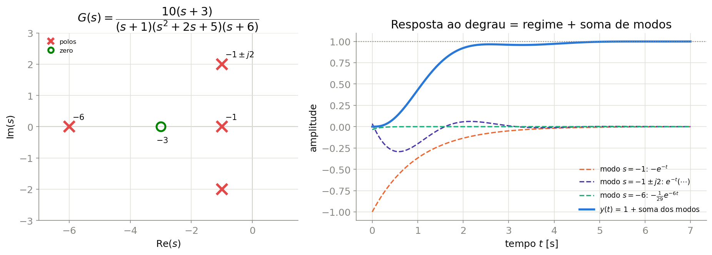
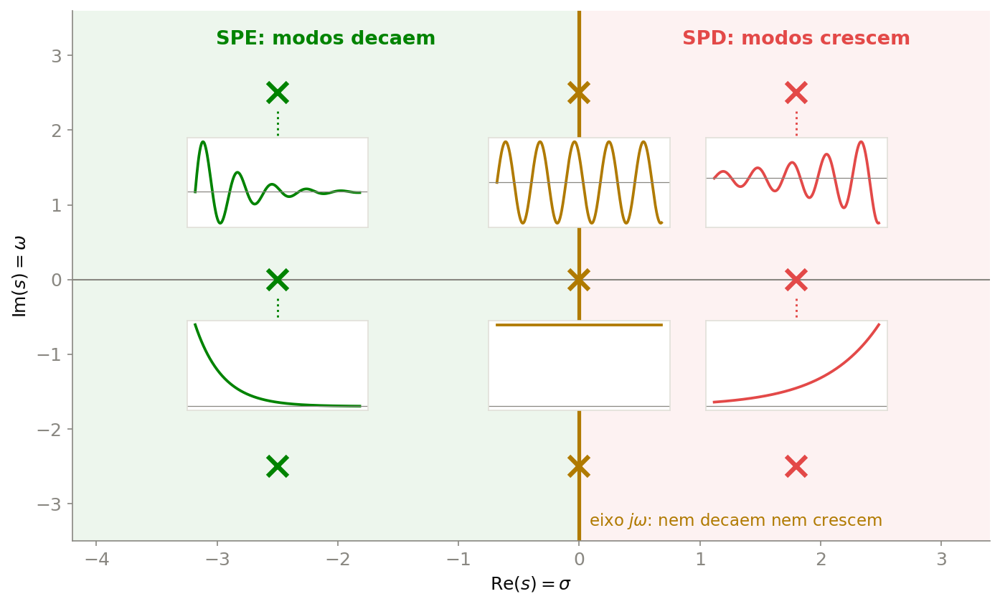
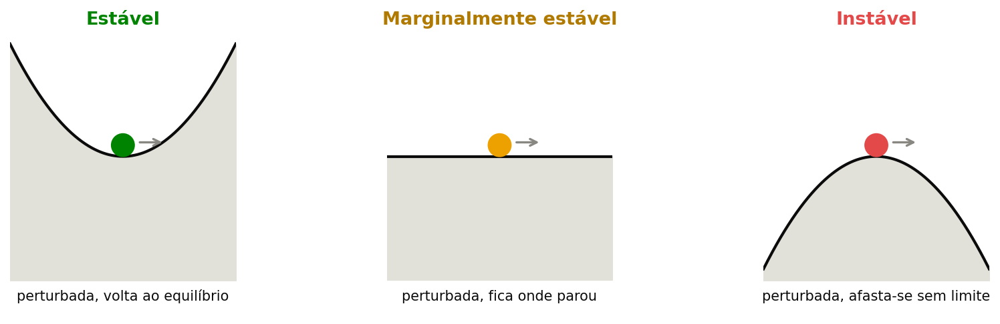
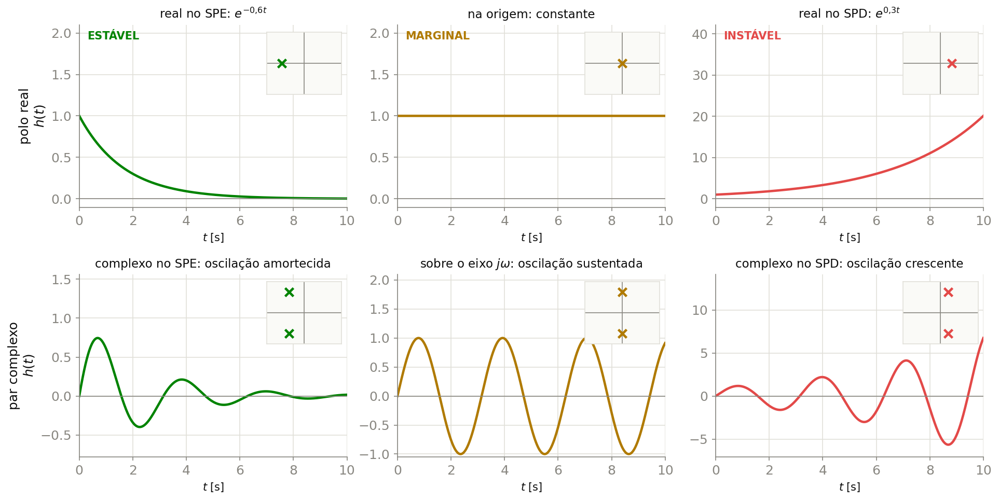
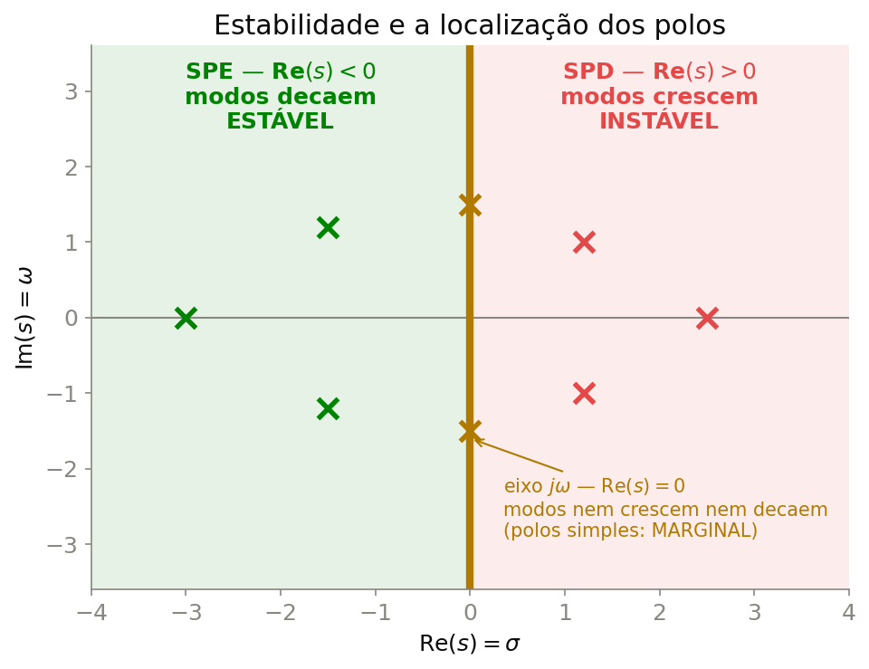
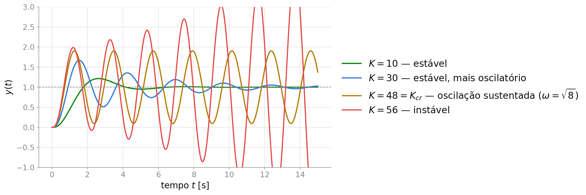
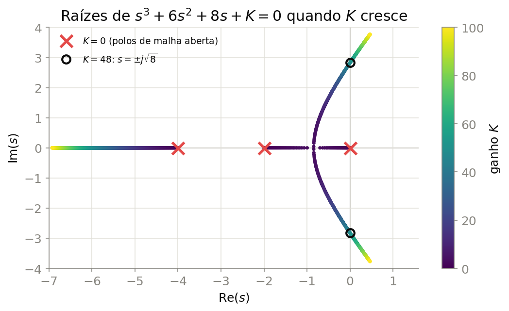

## Onde Estamos

::: {.columns}
::: {.column width="50%"}
**1ª ordem**

$$G(s)=\frac{K}{\tau s+1}$$

**2ª ordem**

$$G(s)=\frac{\omega_n^2}{s^2+2\zeta\omega_n s+\omega_n^2}$$
:::
::: {.column width="50%"}
::: {.callout-warning}
## Duas perguntas novas
1. E se o sistema tiver **3, 4 ou mais polos**, e também **zeros**?
2. E se algum polo estiver **à direita** do eixo imaginário?
:::
:::
:::

---

## Sistemas de Ordem Superior

$$G(s) = \frac{b_m s^m + \cdots + b_1 s + b_0}{a_n s^n + \cdots + a_1 s + a_0} = \frac{K\,(s+z_1)\cdots(s+z_m)}{(s+p_1)\cdots(s+p_n)}, \qquad m\leq n$$

::: {.callout-tip}
## De onde vêm tantos polos?
Cada **armazenador de energia independente** (indutor, capacitor, massa, mola, inércia, tanque) acrescenta um polo — e cada **controlador** ou **sensor** que colocamos na malha também. Ordem alta é a regra, não a exceção.
:::

---

## Exemplo em Malha Aberta: Motor CC (Posição)

```{tikz}
%| echo: false
%| fig-align: center
%| fig-width: 13
\usetikzlibrary{arrows.meta, positioning, calc}
\input{imgs/tikz/OrdemSuperiorMalhaAberta.tikz}
```

Elétrico + mecânico + integrador da posição $\Rightarrow$ **3 polos**.

---

## Exemplo em Malha Fechada: Planta + PI + Sensor

```{tikz}
%| echo: false
%| fig-align: center
%| fig-width: 13
\usetikzlibrary{arrows.meta, positioning, calc}
\input{imgs/tikz/OrdemSuperiorMalhaFechada.tikz}
```

Planta de 2ª ordem, mas a malha fechada tem $2+1+1=$ **4 polos**.

---

## Polos e Zeros de um Sistema de 4ª Ordem

{width="96%" fig-align="center"}

Quatro polos ($-1$, $-1\pm j2$, $-6$), um zero ($-3$), ganho DC $G(0)=\frac{10\cdot3}{1\cdot5\cdot6}=1$.

---

## A Resposta é uma Soma de Modos

Em frações parciais, $Y(s)=G(s)\cdot\frac{1}{s}$ tem **um termo para cada polo**:

$$Y(s) = \frac{1}{s} - \frac{1}{s+1} - \frac{1/29}{s+6} + \frac{1}{29}\,\frac{(s+1)-34}{(s+1)^2+4}$$

$$y(t) = 1 \;-\; e^{-t} \;-\; \tfrac{1}{29}e^{-6t} \;+\; \tfrac{1}{29}e^{-t}\big(\cos 2t - 17\sin 2t\big)$$

O termo $1$ vem da entrada; os demais são os **modos naturais**.

::: {.callout-important}
## Observação-chave
Os **polos** definem a **forma** de cada modo; os **zeros** só alteram os **pesos**. A convergência é uma questão **exclusivamente dos polos**.
:::

---

## Cada Polo, um Modo

{width="78%" fig-align="center"}

---

## O que é Estabilidade? — Intuição

{width="88%" fig-align="center"}

Um sistema é **estável** quando, retirado do equilíbrio por uma perturbação, ele **retorna** ao equilíbrio. É **instável** quando a menor perturbação o leva para cada vez mais longe.

---

## Definição BIBO

::: {.callout-important}
## Estabilidade BIBO (*Bounded Input, Bounded Output*)
Um sistema é **BIBO-estável** se **toda** entrada limitada produz uma saída limitada.
:::

Para sistemas LIT:

$$\text{BIBO-estável} \iff \text{todos os polos de } G(s) \text{ têm } \text{Re}(s)<0$$

Um sistema marginalmente estável **não** é BIBO-estável: uma entrada senoidal na frequência do polo sobre o eixo $j\omega$ produz saída que cresce sem limite (ressonância).

---

## Localização dos Polos e a Resposta ao Impulso

{width="92%" fig-align="center"}

---

## As Três Regiões do Plano $s$

::: {.columns}
::: {.column width="48%"}
{width="100%"}
:::
::: {.column width="52%"}
::: {.callout-important}
## Critério de estabilidade pelos polos
- **Estável**: **todos** os polos com $\text{Re}(s)<0$
- **Marginalmente estável**: nenhum polo no SPD **e** polos **simples** sobre o eixo $j\omega$
- **Instável**: **algum** polo no SPD, **ou** polos **repetidos** sobre o eixo $j\omega$
:::
:::
:::

---

## Exemplo — Classifique

::: {.columns}
::: {.column width="50%"}
**a)** $\;\dfrac{10}{(s+1)(s+2)(s+5)}$ [$\;\to$ **estável**]{.fragment}

<br>

**b)** $\;\dfrac{s-2}{(s+1)(s+3)}$ [$\;\to$ **estável** (zero no SPD não importa)]{.fragment}

<br>

**c)** $\;\dfrac{5}{s\,(s+2)(s^2+2s+10)}$ [$\;\to$ **marginal**]{.fragment}
:::
::: {.column width="50%"}
**d)** $\;\dfrac{1}{(s+1)(s^2+9)^2}$ [$\;\to$ **instável** (duplos em $\pm j3$)]{.fragment}

<br>

**e)** $\;\dfrac{s+1}{(s-1)(s+4)}$ [$\;\to$ **instável** (polo em $+1$)]{.fragment}

<br>

**f)** $\;\dfrac{4}{s^2(s+1)}$ [$\;\to$ **instável** (duplo na origem)]{.fragment}
:::
:::

---

## Estabilidade em Malha Fechada

```{tikz}
%| echo: false
%| fig-align: center
%| fig-width: 6
%| out-width: 60%
\usetikzlibrary{arrows.meta, positioning, calc}
\input{imgs/tikz/MalhaGanhoK.tikz}
```

Com $G(s)=N(s)/D(s)$:

$$H(s)=\frac{K\,G(s)}{1+K\,G(s)}=\frac{K\,N(s)}{D(s)+K\,N(s)} \qquad\Longrightarrow\qquad \boxed{\Delta(s)=D(s)+K\,N(s)}$$

::: {.callout-important}
## Equação característica
Os polos de **malha fechada** são as raízes de $\Delta(s)=0$: **dependem de $K$** e **não são** os polos de malha aberta.
:::

---

## Exemplo Motivador: Ganho Variável

$$G(s)=\frac{1}{s(s+2)(s+4)} \qquad\Longrightarrow\qquad \Delta(s)=s^3+6s^2+8s+K$$

{width="98%" fig-align="center"}

---

## Critério de Routh-Hurwitz: a Tabela

Sem calcular raízes: basta organizar os **coeficientes** de $\Delta(s)=a_ns^n+a_{n-1}s^{n-1}+\cdots+a_0$ numa tabela.

::: {.columns}
::: {.column width="45%"}
$$
\begin{array}{c|cccc}
s^n & a_n & a_{n-2} & a_{n-4} & \cdots \\
s^{n-1} & a_{n-1} & a_{n-3} & a_{n-5} & \cdots \\
s^{n-2} & b_1 & b_2 & \cdots & \\
s^{n-3} & c_1 & \cdots & & \\
\vdots & \vdots & & & \\
s^0 & \ast & & &
\end{array}
$$
:::
::: {.column width="55%"}
1. Linhas $s^n$ e $s^{n-1}$: coeficientes **alternados**
2. Cada elemento novo é um "**produto cruzado**" das duas linhas de cima, dividido pelo **pivô**:

$$b_1 = \frac{a_{n-1}a_{n-2}-a_n\,a_{n-3}}{a_{n-1}}$$
:::
:::

---

## Critério de Routh-Hurwitz: a Regra

::: {.callout-important}
## Regra
O **número de raízes no SPD** é igual ao **número de trocas de sinal** na **primeira coluna** da tabela.

$$\text{Estável} \iff \text{todos os elementos da 1ª coluna têm o mesmo sinal}$$
:::

::: {.callout-tip}
## Simplificando as contas
Uma linha inteira pode ser multiplicada ou dividida por uma constante **positiva** — os sinais da 1ª coluna não mudam.
:::

---

## Routh — Exemplo Passo a Passo {.small}

$\Delta(s)=s^4+2s^3+3s^2+4s+5$

::: {.columns}
::: {.column width="35%"}
$$
\begin{array}{c|ccc}
s^4 & 1 & 3 & 5 \\
s^3 & 2 & 4 & 0 \\
s^2 & \mathbf{1} & 5 & \\
s^1 & \color{red}{\mathbf{-6}} & 0 & \\
s^0 & \mathbf{5} & &
\end{array}
$$
:::
::: {.column width="65%"}
$$b_1=\frac{2\cdot3-1\cdot4}{2}=1,\qquad b_2=\frac{2\cdot5-1\cdot0}{2}=5$$

$$c_1=\frac{1\cdot4-2\cdot5}{1}=-6,\qquad d_1=\frac{(-6)\cdot5-1\cdot0}{-6}=5$$
:::
:::

1ª coluna: $\;+1,\;+2,\;+1,\;\color{red}{-6},\;+5$ $\;\Rightarrow\;$ **duas trocas** ($+1\to-6$ e $-6\to+5$) $\;\Rightarrow\;$ **2 polos no SPD**.

Conferindo: raízes $-1{,}29\pm j0{,}86$ e $\mathbf{+0{,}29\pm j1{,}42}$ ✓

---

## Faixa de $K$ — Exemplo 1 (3ª Ordem)

$G(s)=\dfrac{1}{s(s+2)(s+4)}$ com ganho $K$: $\qquad\Delta(s)=s^3+6s^2+8s+K$

::: {.columns}
::: {.column width="45%"}
$$
\begin{array}{c|cc}
s^3 & 1 & 8 \\
s^2 & 6 & K \\
s^1 & \dfrac{48-K}{6} & 0\\[8pt]
s^0 & K &
\end{array}
$$
:::
::: {.column width="55%"}
Exigindo 1ª coluna positiva:

- linha $s^1$: $\;48-K>0 \;\Rightarrow\; K<48$
- linha $s^0$: $\;K>0$

$$\boxed{0<K<48}$$
:::
:::

---

## Ganho Crítico e Frequência de Oscilação

Em $K=K_{cr}=48$, a linha $s^1$ fica **inteira nula**. O **polinômio auxiliar** vem da linha de cima ($s^2$):

$$P(s)=6s^2+48=0 \quad\Longrightarrow\quad s=\pm j\sqrt8\approx\pm j2{,}83 \text{ rad/s}$$

::: {.columns}
::: {.column width="50%"}
{width="100%"}
:::
::: {.column width="50%"}
- $K<48$: os 3 polos no SPE
- $K=48$: um par sobre o eixo $j\omega$ — **oscilação sustentada**, período $\approx2{,}2$ s
- $K>48$: o par entra no SPD — **instável**
:::
:::

---

## Exemplo 2 — 4ª Ordem com Zero {.small}

$G(s)=\dfrac{s+3}{s(s+1)(s+2)(s+5)}$ com ganho $K$ $\qquad\Longrightarrow\qquad \Delta(s)=s^4+8s^3+17s^2+(K+10)\,s+3K$

::: {.columns}
::: {.column width="45%"}
$$
\begin{array}{c|ccc}
s^4 & 1 & 17 & 3K \\
s^3 & 8 & K+10 & \\
s^2 & \frac{126-K}{8} & 3K & \\[4pt]
s^1 & \frac{1260-76K-K^2}{126-K} & & \\[4pt]
s^0 & 3K & &
\end{array}
$$
:::
::: {.column width="55%"}
Condições (1ª coluna $>0$):

1. $s^2$: $\;K<126$
2. $s^1$: $\;K^2+76K-1260<0$, ou seja, $(K-14)(K+90)<0$
3. $s^0$: $\;K>0$

$$\boxed{0<K<14}$$

Em $K=14$: $\;14s^2+42=0\Rightarrow s=\pm j\sqrt3$
:::
:::

A condição mais restritiva vem da linha $s^1$, não da $s^2$.

---

## Exemplo 3 — Planta Instável {.small}

$G(s)=\dfrac{s+1}{s(s-1)(s+6)}$ — polo em $s=+1$: **instável em malha aberta**.

::: {.columns}
::: {.column width="50%"}
$$\Delta(s)=s^3+5s^2+(K-6)s+K$$

$$
\begin{array}{c|cc}
s^3 & 1 & K-6 \\
s^2 & 5 & K \\
s^1 & \frac{4K-30}{5} & 0\\[4pt]
s^0 & K &
\end{array}
$$
:::
::: {.column width="50%"}
- $s^1$: $\;4K-30>0\Rightarrow K>7{,}5$
- $s^0$: $\;K>0$

$$\boxed{K>7{,}5}$$

Em $K=7{,}5$: $\;5s^2+7{,}5=0\Rightarrow s=\pm j1{,}22$
:::
:::

::: {.callout-important}
## Ganho mínimo
A faixa estável **nem sempre** começa em $K=0$: aqui é preciso ganho **suficiente** para "segurar" o modo instável. Compare com o Exemplo 1, em que ganho **demais** desestabiliza.
:::

---

## Casos Especiais da Tabela de Routh

Duas situações impedem continuar a tabela da forma usual:

::: {.columns}
::: {.column width="50%"}
::: {.callout-warning}
## Caso 1 — Zero na 1ª coluna
O **primeiro** elemento de uma linha é zero, mas **o resto da linha não é** $\Rightarrow$ o próximo pivô seria zero.

**Solução:** trocar o zero por um $\epsilon>0$ pequeno e analisar os sinais com $\epsilon\to0^+$.
:::
:::
::: {.column width="50%"}
::: {.callout-warning}
## Caso 2 — Linha inteira nula
**Todos** os elementos de uma linha são zero $\Rightarrow$ raízes **simétricas em relação à origem** ($\pm\sigma$, $\pm j\omega$, $\pm\sigma\pm j\omega$).

**Solução:** polinômio auxiliar $P(s)$ com a linha de cima; trocar a linha nula pelos coeficientes de $dP/ds$.
:::
:::
:::

---

## Caso Especial 1 — Zero na Primeira Coluna {.small}

$\Delta(s)=s^5+2s^4+3s^3+6s^2+5s+3$

::: {.columns}
::: {.column width="50%"}
$$
\begin{array}{c|ccc}
s^5 & 1 & 3 & 5\\
s^4 & 2 & 6 & 3\\
s^3 & 0\to\epsilon & \frac{7}{2} & \\[4pt]
s^2 & \frac{6\epsilon-7}{\epsilon} & 3 & \\[4pt]
s^1 & \frac{42\epsilon-49-6\epsilon^2}{12\epsilon-14} & & \\[4pt]
s^0 & 3 & &
\end{array}
$$
:::
::: {.column width="50%"}
Com $\epsilon\to0^+$, a 1ª coluna fica:

$$+1,\;\;+2,\;\;+\epsilon,\;\;\color{red}{-\tfrac{7}{\epsilon}},\;\;+\tfrac{7}{2},\;\;+3$$

**2 trocas** $\Rightarrow$ **2 polos no SPD** (de fato: $0{,}34\pm j1{,}51$).
:::
:::

**Alternativa:** inverter a ordem dos coeficientes ($s\to1/s$): $3s^5+5s^4+6s^3+3s^2+2s+1$ tem o mesmo nº de raízes no SPD.

---

## Caso Especial 2 — Linha Inteira Nula {.small}

$\Delta(s)=s^5+7s^4+6s^3+42s^2+8s+56$

::: {.columns}
::: {.column width="50%"}
$$
\begin{array}{c|ccc|l}
s^5 & 1 & 6 & 8 & \\
s^4 & 1 & 6 & 8 & \text{(era } 7\;\,42\;\,56\text{; }\div7)\\
s^3 & 0 & 0 & & \leftarrow\text{linha nula!}\\
s^3 & 1 & 3 & & \leftarrow dP/ds\;(\div4)\\
s^2 & 3 & 8 & & \\
s^1 & \frac13 & & & \\
s^0 & 8 & & &
\end{array}
$$
:::
::: {.column width="50%"}
1. Polinômio auxiliar (linha $s^4$): $\;P(s)=s^4+6s^2+8$
2. $\dfrac{dP}{ds}=4s^3+12s$ $\;\to\;$ nova linha $s^3$
3. 1ª coluna: $1,1,1,3,\tfrac13,8$ — **nenhuma troca**
4. $P(s)=(s^2+2)(s^2+4)$ $\Rightarrow$ $s=\pm j\sqrt2,\;\pm j2$
:::
:::

::: {.callout-important}
## Conclusão
Nenhum polo no SPD, **4 polos simples sobre o eixo $j\omega$** (raízes de $P$) e um em $s=-7$ $\Rightarrow$ **marginalmente estável**.
:::

---

## Interpretando a Linha Nula

- $P(s)$ é **par** (só potências pares de $s$) $\Rightarrow$ suas raízes são **simétricas em relação à origem**, e são também raízes de $\Delta(s)$
- As trocas de sinal **da linha de $P(s)$ para baixo** contam quantas raízes de $P$ estão no SPD
- Para cada raiz de $P$ no SPD há uma simétrica no SPE; as que **sobram** estão sobre o eixo $j\omega$:

$$\#\{\text{raízes de } P \text{ no eixo } j\omega\} = \text{grau}(P) - 2\times\#\{\text{trocas abaixo de } P\}$$

::: {.callout-tip}
## Ligação com o ganho crítico
Foi o que aconteceu nos Exemplos 1–3: no ganho crítico, a linha $s^1$ zera e o polinômio auxiliar da linha $s^2$ dá a **frequência de oscilação** $\omega$.
:::

---

## Verificação Numérica {.small}

::: {.columns}
::: {.column width="50%"}
**Python** (`control`)

```python
import numpy as np
import control as ct

G = ct.tf([1], [1, 6, 8, 0])
for K in [10, 48, 56]:
    H = ct.feedback(K * G, 1)
    print(K, np.round(ct.poles(H), 3))

np.roots([1, 2, 3, 4, 5])
```
:::
::: {.column width="50%"}
**MATLAB**

```matlab
G = tf(1, [1 6 8 0]);
for K = [10 48 56]
    H = feedback(K*G, 1);
    disp(K), disp(pole(H))
end

roots([1 2 3 4 5])
pzmap(feedback(10*G, 1))
```
:::
:::

::: {.callout-tip}
## Software × Routh
O computador confirma a estabilidade para **um** $K$ de cada vez. O Routh-Hurwitz entrega a **faixa inteira** de $K$ de forma analítica — e é isso que usaremos no projeto.
:::

---

## Exercícios (1/2) {.small}

1. Classifique (estável, marginal, instável) pela localização dos polos: (a) $\dfrac{s+2}{(s+1)(s^2+4s+13)}$; (b) $\dfrac{3}{s(s^2+9)}$; (c) $\dfrac{1}{(s^2+1)^2(s+3)}$; (d) $\dfrac{s-5}{(s+2)(s+6)}$.
2. Use a tabela de Routh para determinar quantos polos estão no SPD: $s^3+4s^2+2$; $\;s^4+2s^3-s^2+3s+1$; $\;s^3+3s^2+3s+1$; $\;s^3+s^2+2s+10$.
3. Encontre a faixa de $K$ que torna $s^3+4s^2+5s+K$ estável. Qual a frequência de oscilação no ganho crítico?
4. Monte a tabela de Routh de $s^4+3s^3+5s^2+4s+2$ e conclua sobre a estabilidade.
5. Para $G(s)=\dfrac{K}{(s+1)(s+2)(s+3)}$ com realimentação unitária, determine a faixa de $K>0$ para estabilidade, o ganho crítico e a frequência de oscilação.

---

## Exercícios (2/2) {.small}

6. Para $G(s)=\dfrac{K}{(s-1)(s+2)(s+3)}$ (planta instável), determine a faixa de $K$ que estabiliza a malha fechada. Por que existe um limite **inferior** e um **superior**?
7. (Caso $\epsilon$) Determine o número de raízes no SPD de $s^4+s^3+2s^2+2s+3$. Repita invertendo a ordem dos coeficientes.
8. (Linha nula) Para $s^4+s^3-s-1$, monte a tabela, obtenha o polinômio auxiliar e determine quantas raízes estão no SPD, no SPE e sobre o eixo $j\omega$.
9. Explique, com um exemplo, por que um sistema marginalmente estável não é BIBO-estável.
10. (Ligação com a Aula 6) Para $G(s)=\dfrac{K}{s(s+2)(s+4)}$, calcule $K_v$ e $e_{ss}$ para rampa unitária. Usando a faixa de estabilidade desta aula, qual é o **menor** $e_{ss}$ teoricamente atingível com controle proporcional?
